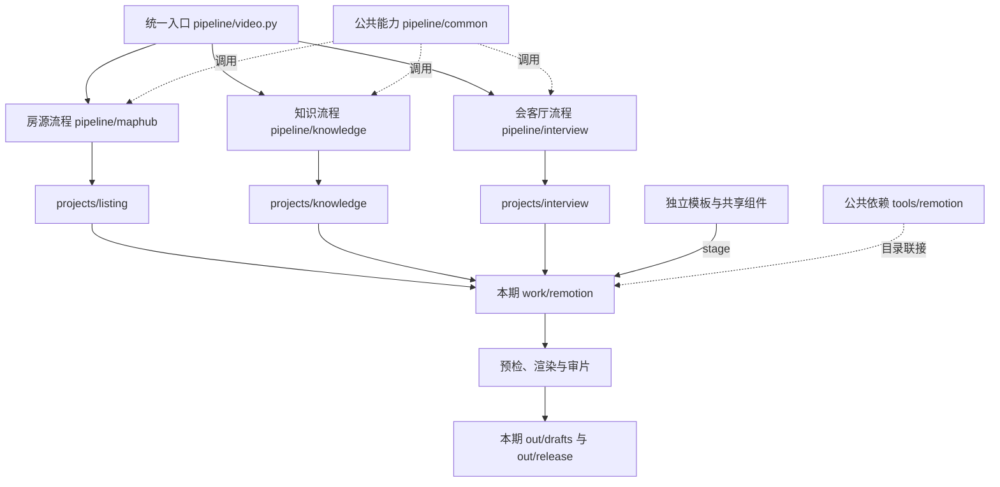

# 生产架构与空间管理

本文件描述 2026-10-24 的架构迁移，以及 2026-10-25 删除测试期和退出旧 project 兼容后的生产架构。生产命令以本文件、README 和 package.json 为准。2026-10-30 起 `projects/map-hub` 兼容联接和 `series: map-hub` 别名已移除，所有房源期只在 `projects/listing`。内容、来源、授权与发布审片规则仍按原规范执行。

## 分类、模板与编号

- 内容目录是 `projects/listing` / `projects/knowledge` / `projects/interview`。房源的 `category` 为 rental / resale / new-home。会客厅的技术标识是 `series: interview`，对外名称是小ONE会客厅。
- map-hub 只是房源渲染模板（templates/map-hub）和流水线（pipeline/maphub）的名称。房源期一律 `series: listing`；`map-hub` 不再是 series 值，未知 series 直接报错。
- 期内目录（raw 只读 + raw_manifest.json、restored/master|proxy、shots、assets、sources/amap|docs、按需创建的其余目录）见 docs/FOOTAGE-SPEC.md。未归期的原始资料放 `projects/listing/_sources/<slug>/`。
- `episode` 是既有标识，`release_number` 是正式发布编号。历史 xihu 测试工程已按用户要求删除。
- `npm run episodes` 只扫描 projects/listing、projects/knowledge、projects/interview 下的 `ep*-*`，并打印 `next_release_number`。
- 下一正式发布编号是现有正式期 `release_number` 的最大值加 1，由 `npm run episodes` 计算。`purpose: test`、`example`、`benchmark` 不占号。不要在文档里写死下一期。

## 共用能力

Python 的实现集中在 pipeline/common；pipeline/maphub 内同名旧入口是兼容转发，导入时引用同一模块对象。知识类直接导入公共实现。

Remotion 的底层代码集中在 templates/shared/remotion/src：字体注册等待、固定分辨率文字位图、跟踪插值、指引线避让、镜头投影、媒体几何、品牌条和平台角标。房源、知识和会客厅三个模板保留各自镜头编排；品牌条和平台角标复用同一实现。ScanAnnotate 使用同一实现。改公共组件后重新 stage 才进入已有工作区，render 会自动 stage。

公共素材在 templates/shared/public。公共 Node 依赖在 tools/remotion，以 package-lock.json 固定；三个模板与每期 workspace 通过目录联接引用它。仅保留当前共用环境；旧 project 渲染器、命令分派和独立 remotion 环境已退役。会客厅模板是 templates/interview/remotion，合成 id 是 InterviewLounge。

Python GPU 环境继续按引擎隔离、按项目共用，路径登记在 config/toolchains.json。CosyVoice 环境同时用于本地抠像，不能因 TTS 主用云端就直接删除。各引擎 numpy/transformers 不同，不能盲目合并。模型留在 vendor 的公共引擎区，不按期安装。

## 存储与清理

- audit 区分文件路径的逻辑字节数与按文件身份去重的 unique_bytes；不递归统计目录联接和符号链接。硬链接没有改变文件夹属性中的逻辑体积，实际释放量以 unique_bytes/磁盘空闲空间衡量。
- compact 默认只生成计划，应用需要 --apply。它只删除带 index.html 和 bundle.js 标记、且未被本期数据引用的 work 构建目录。
- 保留各期原始素材、所有不同内容的粗剪、当前抠像中间结果、授权资料与脚本。不会为凑体积删除原始素材或精简画质。
- 内容哈希完全相同的生成 public 副本及草稿别名可合并为硬链接，所有原路径保留。raw、original、consent、clone 不参与。
- 生成 public 的复制和渲染输出使用临时文件 + 原子替换；后续更新会分离硬链接，不覆盖另一份历史输出。不要手工原地编辑 public 或草稿硬链接；修改源素材后重跑对应阶段，或写入新文件再替换。
- 引用清单、前后体积、合并的 SHA256 和被清理的构建路径写入 --report 指定的 JSON；报告不含凭证或房源业务字段。
- 不固定保留几份不同粗剪，也不自动删除旧版本；避免丢失不可忠实重现的编辑历史。

## 验证入口

```powershell
python -B -m unittest pipeline.common.test_architecture -v
python -B pipeline/maphub/test_workflow.py -v
python -B pipeline/maphub/test_overlay_contract.py -v
python -B -m unittest pipeline.interview.test_interview -v
python -B -m unittest pipeline.common.test_color_restore pipeline.common.test_raw_manifest pipeline.common.test_map_profile pipeline.common.test_production_contract -v
python -B scripts/new_episode.py --self-test
npm run typecheck
npm run check -- projects/listing/ep02-zidong --draft
npm run check -- projects/knowledge/ep01-intro --draft
npm run check -- projects/interview/ep00-techtest --draft
python pipeline/maphub/check_overlay_motion.py projects/listing/ep02-zidong
```

代表镜头应对比迁移前后 PNG 像素，确认公共化不改变既有画面；字体、地图、室内跟踪各取不同镜头。技术重构验证不等于完整新成片已获发布确认。历史测试期若原有脚本/配音清单过期，必须显示原始错误，不绕过检查或自动生成新数字人。


## 跨 agent 生产

按 docs/PRODUCTION.md 接手，先运行 npm run doctor。新建模板为 templates/listing/episode.json；发布资料为 compliance.json，实际旁白取 data/timeline.json。旧 project.json 不能代替新工程或发布资料。外部登录、素材与额度仍按各类型 RUNBOOK 准备。

## 现行生产架构


